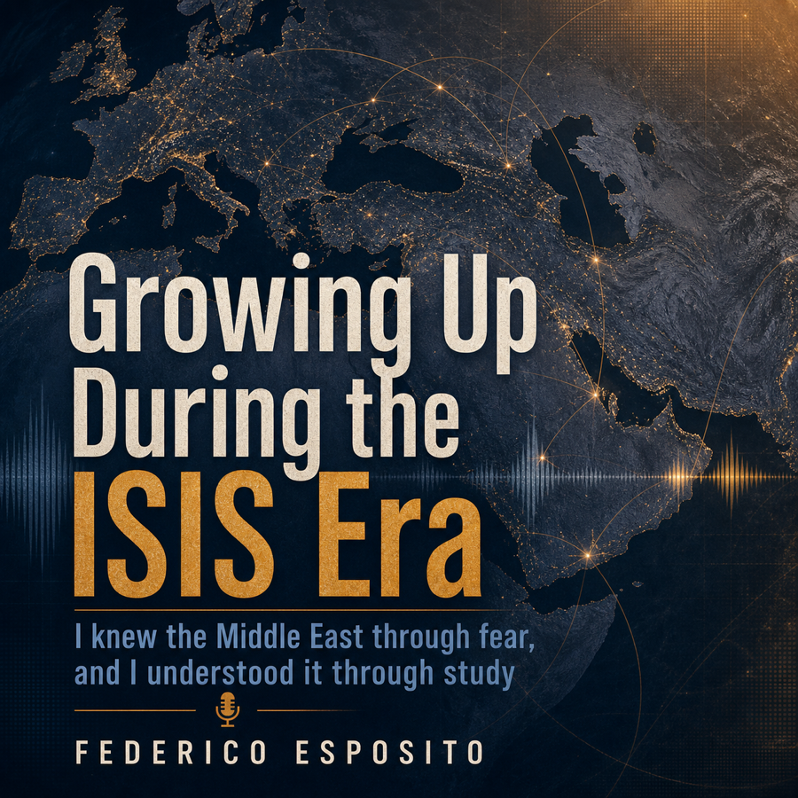

# Growing Up During the ISIS Era

A podcast by Federico Esposito · 26 minutes · International Relations of the Middle East, John Cabot University · Summer 2026

*I knew the Middle East through fear, and I understood it through study.*

<audio controls preload="none" src="https://federicoespositoir.github.io/podcast-growing-up-isis-era/growing-up-during-the-isis-era.mp3"></audio>

[Listen to the episode](https://federicoespositoir.github.io/podcast-growing-up-isis-era/growing-up-during-the-isis-era.mp3)

## About the episode

I was in middle school when the Charlie Hebdo attack happened. For my generation in Europe, the Middle East first arrived through breaking news: Charlie Hebdo, the Bataclan, ISIS, the refugee crisis. This episode goes back to that first image and asks how it was built, and what changed once I studied the history and the international relations of the region.

## Outline

1. The first image and Charlie Hebdo
2. Paris, refugees and securitisation
3. The historical correction: ISIS was not timeless Islam
4. Vienna and terrorism after the Caliphate
5. What studying changed

## What it shows

I wrote the script from academic sources, then recorded and edited the episode myself in GarageBand. The script draws on the literature on securitisation, media coverage of terrorism and the history of the modern Middle East.

## Main sources

- Goldschmidt, A., & Al-Marashi, I. (2024). *A Concise History of the Middle East* (13th ed.). Routledge.
- Hansen, L. (2011). The politics of securitization and the Muhammad cartoon crisis. *Security Dialogue, 42*(4-5), 357-369.
- Institute for Economics & Peace. (2025). *Global Terrorism Index 2025*.
- Nail, T. (2016). A tale of two crises: Migration and terrorism after the Paris attacks. *Studies in Ethnicity and Nationalism, 16*(1), 158-167.
- Połońska-Kimunguyi, E., & Gillespie, M. (2016). Terrorism discourse on French international broadcasting. *European Journal of Communication, 31*(5), 568-583.

The episode includes short excerpts from news broadcasts, used for commentary.

[Federico Esposito: research portfolio](https://federicoespositoir.github.io/)
